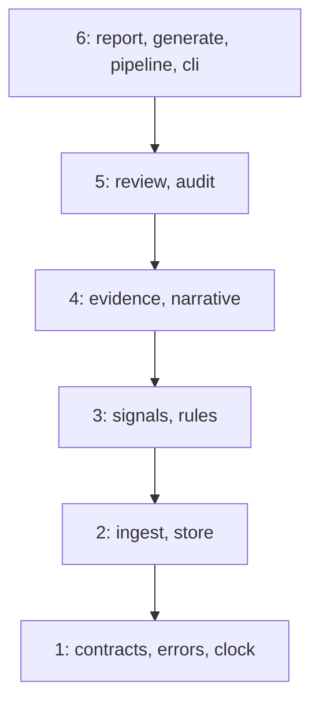

# Design

First draft, written at M1: the layers. Each later milestone adds a few lines on what it builds.

## Layers

Each module in `src/mule_triage/` sits in one layer, and may import its own layer or the ones
below, never above. `tests/architecture/test_layers.py` enforces this, and fails on any module
that isn't in the map. `__init__.py` and `__main__.py` are exempt, because they have rules of
their own.

So far `cli.py`, `contracts.py`, `errors.py`, `ingest.py`, `store.py` and `pipeline.py` exist,
and `cli.py` only parses arguments.
It's the composition root: as modules arrive, it builds the real implementations and passes them
in, and it's the only module that may print, read the wall clock or catch broadly.

## Contracts

Written at M2. `contracts.py` (layer 1) holds the data that crosses a boundary, and computes
nothing:

- **Inputs:** `Payment` and `AccountProfile` are pydantic models that are strict, frozen and
  refuse unknown fields. A name field, a time without a timezone, or an amount that isn't whole
  cents is rejected rather than coerced, and times are read as UTC (`tests/unit/test_contracts.py`).
  Ingest must read each line with `model_validate_json`: strict mode rejects a time given as text
  in a Python dictionary, so `model_validate(json.loads(line))` would reject every valid line.
- **Signal values:** `Known`, `Unknown` (with its reason code) and `Conflict`, so missing or
  contradictory data is a value the rules must handle, never a silent zero.
- **Results:** each account gets exactly one of `Alert`, `NeedsReview` or `NoAlert`, with its
  reason codes as a set. Only an `Alert` carries a priority and the INCOMPLETE flag. `RunResult`
  adds the payment ingest counts and the rejected and duplicate IDs.

`pipeline.run` takes the two input paths, the as-of time and `Settings` (only the database path
so far). From M3 it ingests and stores the run, then raises `NotImplementedError` where the
signals will go, until M4. The two golden outcome tests are marked as expected failures for that
exception alone, so any other error turns them red.

## Store and reconciliation

Written at M3. `store.py` (layer 2) keeps payments, profiles, rejections, duplicates and a run
ledger in one SQLite file in WAL mode; `ingest.py` only parses, and a record already stored is
recorded as a duplicate if it's identical and rejected if it differs, so a re-run adds nothing.
Before committing, `pipeline.reconcile` checks per file that the lines read, as recorded in the
ledger, equal the run's stored accepted, rejected and duplicate rows, and otherwise raises
`ReconciliationError`, which rolls the whole run back.

## Evidence pack

Written at M5a. `evidence.build_pack` (layer 4) is a pure function of one account's activity
and the rules. It takes the outcome from `rules.outcome_for` and the numbers from `signals.py`'s
own measures, so the pipeline's results come from the packs and can't disagree with them. Every
fact has an ID taken from its record (`P-TX-101-01`, `PR-ACC-101`, `S-FAN_IN`), a source, a record
ID, and an event time and a knowledge time in UTC. A signal's source is `rules v1`, and its times
are the as-of time. A ratio is rounded down and hours are rounded up, so a value just short of a
threshold never looks as if it reached it (`tests/unit/test_evidence.py`). Counterparties are
ranked by total in both directions, then by account ID, and capped by `[evidence]
max_counterparties`, which limits only that list. The facts' JSON is canonical, and its SHA-256
is stored on the case, so the version rises when a reviewer would see different facts. That
includes a changed threshold, even when the outcome holds. The hash covers exact values (cents,
the exact ratio, microseconds and the thresholds) and codes, never the wording or the rounding,
so rewording a label changes no case. Payment references are kept in full, as quoted data,
because an investigator needs them; they're free text and may hold a name, so the packs, and
from M6 the model's input, can carry personal data. `report.py` (layer 6) writes
`<account>_<as-of>.md` and `.json` under `--out` for every case at the run's as-of time, after the
commit. In Markdown every ID and reference is inline code, and the pack uses lists, because a pipe
would split a table cell. The store's schema now has a version, and an older database is refused
with a message rather than failing on a missing column.

## The four boundaries

| Boundary | What happens there | Who owns it |
|---|---|---|
| Signal | each signal is Known, Unknown or Conflict, and each account gets one outcome | the rules: `signals` and `rules`, layer 3 |
| Investigation | an evidence pack and a draft narrative; the model never sets an outcome or a priority | the investigator, helped by `evidence` and `narrative`, layer 4 |
| Decision | the investigator's disposition, recorded in an audit table that refuses updates and deletes | the investigator: `review` and `audit`, layer 5 |
| Action | freezing, reporting or contacting an account | people and systems outside the tool, which does nothing here |

Only the contracts exist so far: layers 3 to 5 are planned for M4 to M6.

## Code rules the architecture tests enforce

Over `src/`, from `tests/architecture/test_code_rules.py`:

- no wall clock outside `cli.py`: `datetime.now`, `utcnow` and `today`, `date.today`,
  `time.time` and `time.time_ns`, whether called or passed by name, and through import aliases;
  `time.perf_counter()` is allowed for measuring durations;
- no bare or broad `except` outside `cli.py`, and no `print()` outside `cli.py`;
- no mutable default arguments;
- no SQL built from text (an f-string, `+`, `%` or `.format()`), whether passed straight to
  `execute()` or holding an SQL keyword anywhere;
- no `eval`, `exec`, `pickle`, `shell=True`, `os.system` or `os.popen`.

Over `src/` and `tests/`, from `tests/architecture/test_structure.py`: every folder holding
Python has an empty `__init__.py`, `__main__.py` is exactly the two-line shim calling
`cli.main()`, and imports are absolute. `scripts/` imports only the standard library.

Each rule also has a test that feeds it a small bad snippet and expects a violation, so no rule
can pass by never firing.
