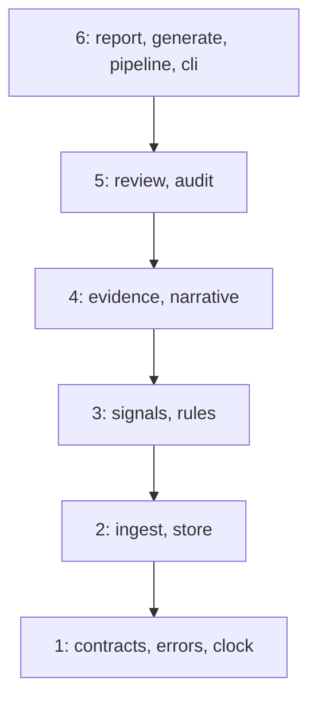

# Design

First draft, written at M1: the layers. Each later milestone adds a few lines on what it builds.

## Layers

Each module in `src/mule_triage/` sits in one layer, and may import its own layer or the ones
below, never above. `tests/architecture/test_layers.py` enforces this, and fails on any module
that isn't in the map. `__init__.py` and `__main__.py` are exempt, because they have rules of
their own.

Only `cli.py` exists so far, and it only parses arguments. It's the composition root: as modules
arrive, it builds the real implementations and passes them in, and it's the only module that may
print, read the wall clock or catch broadly.

## Code rules the architecture tests enforce

Over `src/`, from `tests/architecture/test_code_rules.py`:

- no wall clock outside `cli.py`: `datetime.now`, `utcnow` and `today`, `date.today`,
  `time.time` and `time.time_ns`, whether called or passed by name, and through import aliases;
  `time.perf_counter()` is allowed for measuring durations;
- no bare or broad `except` outside `cli.py`, and no `print()` outside `cli.py`;
- no mutable default arguments;
- no SQL built from text (an f-string, `+`, `%` or `.format()`), whether passed straight to
  `execute()` or holding an SQL keyword anywhere;
- no `eval`, `exec`, `pickle`, `shell=True`, `os.system` or `os.popen`.

Over `src/` and `tests/`, from `tests/architecture/test_structure.py`: every folder holding
Python has an empty `__init__.py`, `__main__.py` is exactly the two-line shim calling
`cli.main()`, and imports are absolute. `scripts/` imports only the standard library.

Each rule also has a test that feeds it a small bad snippet and expects a violation, so no rule
can pass by never firing.
