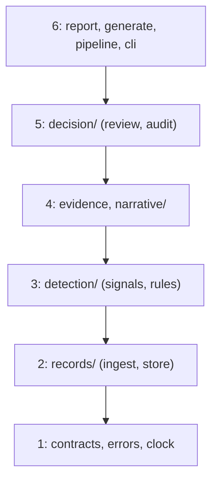

# Design

First draft, written at M1: the layers. Each later milestone adds a few lines on what it builds.

## Layers

Each module in `src/mule_triage/` sits in one layer, and may import its own layer or the ones
below, never above. `tests/architecture/test_layers.py` enforces this, and fails on any module
that isn't in the map. `__init__.py` and `__main__.py` are exempt, because they have rules of
their own.

At M5b every module but `narrative.py` (M6) and `generate.py` (G) exists. At M6 the narrative
became a sub-package, `narrative/`, whose modules all sit in layer 4: `prompt.py`,
`validator.py`, `template.py` and `narrator.py` are pure, and `client.py` is an edge. At S, with
no logic change, `ingest` and `store` moved into `records/`, `signals` and `rules` into
`detection/`, and `review` and `audit` into `decision/`. Each sub-package holds one layer, so the
layer map names the sub-package, and a test planting an import from `decision` in
`detection/signals.py` turns it red. `contracts`, `errors` and `clock` stay at the top because
every layer imports them, `evidence` stays beside `narrative/`, and so do `report`, `pipeline`
and `cli`. The core is pure:
`signals`, `rules` and `evidence` compute from records they're given. The edges are the store,
the audit log, the report files and the command line. `cli.py` is the composition root: it builds
the real implementations, including the wall clock, and passes them in, and it's the only module
that may print, read the wall clock or catch broadly.

## Contracts

Written at M2. `contracts.py` (layer 1) holds the data that crosses a boundary, and computes
nothing:

- **Inputs:** `Payment` and `AccountProfile` are pydantic models that are strict, frozen and
  refuse unknown fields. A name field, a time without a timezone, or an amount that isn't whole
  cents is rejected rather than coerced, and times are read as UTC (`tests/unit/test_contracts.py`).
  Ingest must read each line with `model_validate_json`: strict mode rejects a time given as text
  in a Python dictionary, so `model_validate(json.loads(line))` would reject every valid line.
- **Signal values:** `Known`, `Unknown` (with its reason code) and `Conflict`, so missing or
  contradictory data is a value the rules must handle, never a silent zero.
- **Results:** each account gets exactly one of `Alert`, `NeedsReview` or `NoAlert`, with its
  reason codes as a set. Only an `Alert` carries a priority and the INCOMPLETE flag. `RunResult`
  adds the payment ingest counts and the rejected and duplicate IDs.

`pipeline.run` takes the two input paths, the as-of time and `Settings` (only the database path
so far). From M3 it ingests and stores the run, then raises `NotImplementedError` where the
signals will go, until M4. The two golden outcome tests are marked as expected failures for that
exception alone, so any other error turns them red.

## Store and reconciliation

Written at M3. `records/store.py` (layer 2) keeps payments, profiles, rejections, duplicates and
a run ledger in one SQLite file in WAL mode; `records/ingest.py` only parses, and a record already
stored is
recorded as a duplicate if it's identical and rejected if it differs, so a re-run adds nothing.
Before committing, `pipeline.reconcile` checks per file that the lines read, as recorded in the
ledger, equal the run's stored accepted, rejected and duplicate rows, and otherwise raises
`ReconciliationError`, which rolls the whole run back.

## Evidence pack

Written at M5a. `evidence.build_pack` (layer 4) is a pure function of one account's activity
and the rules. It takes the outcome from `rules.outcome_for` and the numbers from
`detection/signals.py`'s own measures, so the pipeline's results come from the packs and can't disagree with them. Every
fact has an ID taken from its record (`P-TX-101-01`, `PR-ACC-101`, `S-FAN_IN`), a source, a record
ID, and an event time and a knowledge time in UTC. A signal's source is `rules v1`, and its times
are the as-of time. A ratio is rounded down and hours are rounded up, so a value just short of a
threshold never looks as if it reached it (`tests/unit/test_evidence.py`). Counterparties are
ranked by total in both directions, then by account ID, and capped by `[evidence]
max_counterparties`, which limits only that list. The facts' JSON is canonical, and its SHA-256
is stored on the case, so the version rises when a reviewer would see different facts. That
includes a changed threshold, even when the outcome holds. The hash covers exact values (cents,
the exact ratio, microseconds and the thresholds) and codes, never the wording or the rounding,
so rewording a label changes no case. Payment references are kept in full, as quoted data,
because an investigator needs them; they're free text and may hold a name, so the packs, and
from M6 the model's input, can carry personal data. `report.py` (layer 6) writes
`<account>_<as-of>.md` and `.json` under `--out` for every case at the run's as-of time, after the
commit. In Markdown every ID and reference is inline code, and the pack uses lists, because a pipe
would split a table cell. The store's schema now has a version, and an older database is refused
with a message rather than failing on a missing column.

## Audit and dispositions

Written at M5b. `decision/audit.py` keeps one table, `audit_events`, for every audited event: its type,
the case (account and as-of time), the time from the injected clock, and a JSON payload. Triggers
refuse UPDATE and DELETE, and an INSERT that reuses an event ID, because INSERT OR REPLACE would
otherwise remove the old row without firing the delete trigger (`tests/integration/test_audit.py`,
on a real file). A run audits each case it opens, changes or reopens, with its run ID, in the
run's transaction, so a failed run leaves no event behind. `review.dispose` takes the version the
reviewer saw and makes one `UPDATE ... WHERE version = ?`, with its audit event, inside `BEGIN
IMMEDIATE`. It closes the case and raises its version, so of two reviewers on one version only the
first wins, and the second gets a `Stale` result telling them to re-read the case (exit code 5).
A later run that changes a closed case reopens it, and the disposition stays in the audit table.
`show` rebuilds the pack from the stored records and warns if it differs from the stored case.
Not covered: anyone who can write to the file can drop the triggers. They stop the tool and
ordinary SQL from rewriting history, but they don't make the file tamper-proof.

## The AI boundary

Written at M6. `narrative/narrator.py` drafts a narrative for each ALERT case that opens or
changes in a run, after the run commits, so a slow model never holds the database. A
NEEDS_REVIEW case always gets the template, and the model is never asked. The model sees only
the prompt: this case's facts as escaped JSON, never the outcome. Its reply counts only if
`narrative/validator.py` accepts it; otherwise the reviewer gets the template and the reason.
`--ai` picks the client behind `ModelClient.draft`:

- `off` never drafts;
- `replay`, the default, reads `tests/ai/recorded/<model>_<prompt version>_<facts hash>.json`,
  keyed by the same `facts_sha256` the case stores, over canonical JSON; a missing recording
  gives the template and counts as NO_RECORDING;
- `live` calls Ollama's `/api/chat` with streaming off, temperature 0, seed 42, the reply's JSON
  Schema in `format` and `num_ctx` 8192, ignoring proxy settings
  (`tests/unit/narrative/test_client.py`, against a stub server). An unreachable or slow model,
  or one that isn't pulled, gives the template, counts as AI_UNAVAILABLE for the rest of the
  run and exits 4, and the run is still stored (`tests/integration/test_narrative_run.py`). A
  reply that isn't Ollama's shape, or is over 1 MB, is REJECTED for its case alone. The reason
  is a fixed message, never the error's text, which can quote the server. `--record` saves
  each reply with the model's digest from `/api/tags`, and no times.

A test pins a fingerprint of the instructions, the reply's schema and the model's options to
`narrative-v1`, so a change to any of them fails until `PROMPT_VERSION` is raised and the
replies are recorded again.

Each narrative is a `NARRATIVE` audit event: the outcome, live or replay, the model and its
digest, the prompt version, the facts hash, the raw reply, the verdict and the template's
reasons. The raw reply can hold personal data, as the packs can. Not covered: a crash between
the run's commit and the narrative events leaves those cases without a narrative, and a re-run
that changes no case drafts none.

## Data flow

1. `run` reads payments and profiles as JSON Lines, and `ingest` validates each line.
2. In one transaction, the store keeps new records and records rejections and duplicates, and
   reconciliation checks that every line is accounted for.
3. From every stored record known by the as-of time, `evidence` builds each account's pack, with
   its outcome from `signals` and `rules`.
4. The store saves each case's outcome and facts hash, and each change is audited. Then the
   transaction commits.
5. `report` writes each case's pack under `--out`. A reviewer reads one with `show` and records
   a decision with `dispose`.

## Privacy

- Data is synthetic, and accounts and reviewers are pseudonymous IDs; the contracts refuse a
  name field.
- Minimisation: a pack holds only the payments in the signal window and the account's own
  profile, and only the facts behind the signals. References are kept in full (see the evidence
  pack, above).
- No personal data in logs: the tool doesn't log yet (M7). The run's console summary is account
  IDs, codes and counts, and the audit payloads hold IDs, codes and hashes only. `show` prints a
  whole pack, references included, so like the pack files its output can hold personal data.

## Likely production shape

Not built, and not tested. Ingestion would stream payments into Parquet on object storage,
partitioned by day, with the rules reading a snapshot by knowledge time. Cases would go to the
bank's case management system through a transactional outbox, written in the same transaction as
the case change, so a case and its message can't disagree. The tool would run in containers on a
managed cloud platform, with secrets in a vault and least-privilege access for each service.
The narrative model would run on a private endpoint in the same region, validated and monitored
under the bank's model risk process.

## The four boundaries

| Boundary | What happens there | Who owns it |
|---|---|---|
| Signal | each signal is Known, Unknown or Conflict, and each account gets one outcome | the rules: `signals` and `rules` in `detection/`, layer 3 |
| Investigation | an evidence pack and a draft narrative; the model never sets an outcome or a priority | the investigator, helped by `evidence` and `narrative`, layer 4 |
| Decision | the investigator's disposition, recorded in an audit table that refuses updates and deletes | the investigator: `review` and `audit` in `decision/`, layer 5 |
| Action | freezing, reporting or contacting an account | people and systems outside the tool, which does nothing here |

At M5b every boundary but the narrative (M6) is built.

## Code rules the architecture tests enforce

Over `src/`, from `tests/architecture/test_code_rules.py`:

- no wall clock outside `cli.py`: `datetime.now`, `utcnow` and `today`, `date.today`,
  `time.time` and `time.time_ns`, whether called or passed by name, and through import aliases;
  `time.perf_counter()` is allowed for measuring durations;
- no bare or broad `except` outside `cli.py`, and no `print()` outside `cli.py`;
- no mutable default arguments;
- no SQL built from text (an f-string, `+`, `%` or `.format()`), whether passed straight to
  `execute()` or holding an SQL keyword anywhere;
- no `eval`, `exec`, `pickle`, `shell=True`, `os.system` or `os.popen`.

Over `src/` and `tests/`, from `tests/architecture/test_structure.py`: every folder holding
Python has an empty `__init__.py`, `__main__.py` is exactly the two-line shim calling
`cli.main()`, and imports are absolute. `scripts/` imports only the standard library.

Each rule also has a test that feeds it a small bad snippet and expects a violation, so no rule
can pass by never firing.
