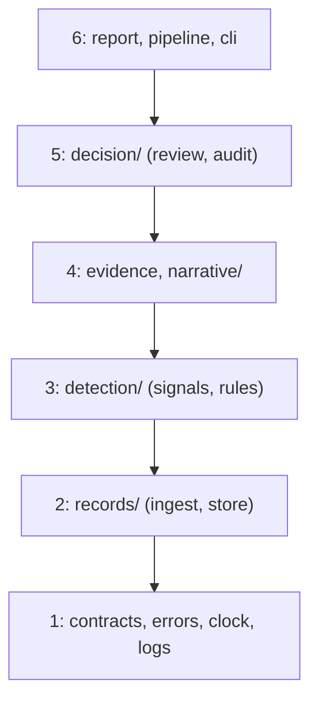
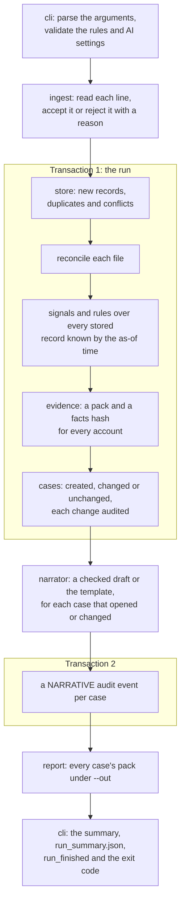
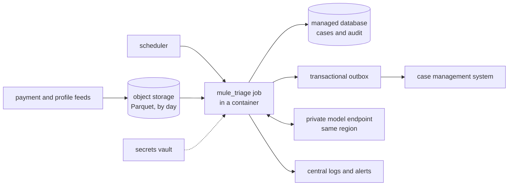

# Design

How mule_triage is built: its layers, the path a run takes, the boundaries between rules,
evidence, AI and people, and the choices behind them. The decisions that cost something are
recorded in [`decisions.md`](decisions.md).

## At a glance

- **A pure core.** Signals, rules, the evidence pack, the prompt, the validator and the template
  compute from what they're given, with no database, files, clock or network.
- **Side effects at the edges:** the SQLite store and audit table, the model client, the report
  files and the command line.
- **One composition root.** `cli.py` parses the arguments, validates the settings once, builds
  the real implementations (the wall clock, the store and the model client) and passes them in.
  It's the only module that may print, read the wall clock or catch broadly.
- **Honest states as types.** A signal is `Known`, `Unknown` or `Conflict`; an account gets
  exactly one of `Alert`, `NeedsReview` or `NoAlert`; an expected failure, such as a rejected
  line or a stale disposition, is a value returned, not an exception raised.

## Layers

Each module sits in one layer, and may import its own layer or the ones below, never above.

| Layer | Module | Responsibility |
| --- | --- | --- |
| 1 | `contracts.py` | The data that crosses a boundary: the inputs, the rules, the signal values and the results |
| 1 | `errors.py` | A small exception hierarchy, for the exceptional only |
| 1 | `clock.py` | Time, injected: `cli.py` passes the wall clock, and tests pass a fixed one |
| 1 | `logs.py` | The log format: each record is one event of one run, as one line of JSON |
| 2 | `records/ingest.py` | Reads each file's lines into accepted records and rejections; it never writes |
| 2 | `records/store.py` | The SQLite store: each run in one transaction, tallied from its own rows |
| 3 | `detection/signals.py` | The three signals, as pure functions of one account's activity |
| 3 | `detection/rules.py` | From one account's signals to its one outcome |
| 4 | `evidence.py` | The evidence pack: one case's outcome and the facts behind it, and their hash |
| 4 | `narrative/` | `prompt.py`, `validator.py`, `template.py` and `narrator.py`, all pure, and `client.py`, the edge to the model |
| 5 | `decision/audit.py` | The append-only audit table |
| 5 | `decision/review.py` | A reviewer's disposition, with its version check, and the case view |
| 6 | `report.py` | Each pack as Markdown and JSON |
| 6 | `pipeline.py` | One run, from the input files to the stored cases, narratives and reports |
| 6 | `cli.py` | The composition root: the commands, the settings, the summary, the logs and the exit codes |

`tests/architecture/test_layers.py` enforces the map, and fails on any module that isn't in it.
A sub-package holds one layer, so the map names the sub-package. The test's own cases plant an
import from a higher layer, such as `decision` in `records/ingest.py` or `cli` in
`records/store.py`, and an unmapped module, and expect each to be flagged. `__init__.py` and
`__main__.py` are exempt, because they have rules of their own.

## Data flow

1. `cli` validates the rules file and the AI settings before reading any input. A bad setting
   exits 2 and stores nothing.
2. `ingest` validates each line with `model_validate_json` against strict contracts. A rejection
   keeps its line number, its record ID if one can be read, and a reason built from the field and
   the error type, such as `event_time: timezone_aware`, never the rejected value.
3. In one transaction, the store keeps new records. A record already stored is a duplicate if
   it's identical and rejected as `changed_since_stored` if it differs, so a re-run adds nothing.
   `pipeline.reconcile` then checks, per file, that the lines read, as recorded in the run ledger,
   equal the run's stored accepted, rejected and duplicate rows. If not, `ReconciliationError`
   rolls the whole run back, and the command exits 3.
4. In the same transaction, the signals read every stored payment and profile known by the
   as-of time, not only this run's records, because on a re-run every line is a duplicate.
   `evidence` builds each account's pack, with its outcome from `detection/`, and each case is
   created, changed or left alone. Each change is audited with its run ID. Then the transaction
   commits, and `run_stored` is logged.
5. After the commit, so a slow model never holds the database, each case that opened or changed
   gets its narrative. An ALERT asks the model client and validates its reply; a NEEDS_REVIEW
   case always gets the template. Each narrative is a NARRATIVE audit event, written in a second
   transaction.
6. `report` writes every case at this as-of time as Markdown and JSON under `--out`.
7. `cli` prints the run summary, saves it as `run_summary.json`, logs `run_finished`, and exits 0,
   or 4 if the model was unavailable.
8. Later, a reviewer reads a case with `show` and records a decision with `dispose`.

## The four boundaries

| Boundary | What happens there | Who owns it |
| --- | --- | --- |
| Signal | Each signal is Known, Unknown or Conflict, and each account gets one outcome | The rules: `signals` and `rules` in `detection/`, layer 3 |
| Investigation | An evidence pack and a draft narrative; the model never sets an outcome or a priority | The investigator, helped by `evidence` and `narrative/`, layer 4 |
| Decision | The investigator's disposition, recorded in an audit table that refuses updates and deletes | The investigator: `review` and `audit` in `decision/`, layer 5 |
| Action | Freezing, reporting or contacting an account | People and systems outside the tool, which does nothing here |

The model sits inside the investigation boundary. Nothing it returns reaches an outcome, a
priority or a disposition.

## Contracts

`contracts.py` holds the data that crosses a boundary, and computes nothing.

- **Inputs:** `Payment` and `AccountProfile` are pydantic models that are strict, frozen and
  refuse unknown fields. A name field, a time without a timezone, or an amount that isn't whole
  cents is rejected rather than coerced, and times are read as UTC
  (`tests/unit/test_contracts.py`). Ingest must read each line with `model_validate_json`: strict
  mode rejects a time given as text in a Python dictionary, so `model_validate(json.loads(line))`
  would reject every valid line.
- **Rules:** `RulesConfig` is strict and frozen too, read from TOML with floats as `Decimal`, so
  a ratio of 0.80 is exactly four fifths. A missing, invalid or unknown setting stops the run.
- **Signal values:** `Known`, `Unknown` (with its reason code) and `Conflict`, so missing or
  contradictory data is a value the rules must handle, never a silent zero.
- **Results:** each account gets exactly one of `Alert`, `NeedsReview` or `NoAlert`, with its
  reason codes as a set. Only an `Alert` carries a priority and the INCOMPLETE flag. A
  `RunResult` holds the run's ingest counts, its rejected and duplicate payment IDs, each
  account's result, the case counts and each narrative's outcome.

`pipeline.run` takes the two input paths, the as-of time and `Settings`: the database path, the
validated rules, the output folder, the clock and the model client.

## Store and reconciliation

`records/store.py` keeps payments, profiles, rejections, duplicates, cases and a run ledger in one
SQLite file in WAL mode, with a five-second busy timeout. `records/ingest.py` only parses. The
store's schema has a version, and an older database is refused with a message rather than
failing on a missing column. Every query uses `?` placeholders.

## Evidence pack

`evidence.build_pack` is a pure function of one account's activity and the rules. It takes the
outcome from `rules.outcome_for` and the numbers from `detection/signals.py`'s own measures, so
the pipeline's results come from the packs and can't disagree with them.

- **Every fact is cited.** Each has an ID taken from its record (`P-TX-101-01`, `PR-ACC-101`,
  `S-FAN_IN`), a source, a record ID, and an event time and a knowledge time in UTC. A signal's
  source is `rules v1`, and its times are the as-of time.
- **Numbers never flatter a breach.** A ratio is rounded down and hours are rounded up, so a value
  just short of a threshold never looks as if it reached it (`tests/unit/test_evidence.py`).
- **A capped counterparty list.** Counterparties are ranked by total in both directions, then by
  account ID, and capped by `[evidence] max_counterparties`, with a count of those left out
  ("5 of 9 shown; 4 left out" for ACC-101). The cap limits only that list, never the facts.
- **A facts hash.** The facts' JSON is canonical, and its SHA-256 is stored on the case, so the
  version rises when a reviewer would see different facts, including a changed threshold that
  leaves the outcome as it was. The hash covers exact values (cents, the exact ratio,
  microseconds and the thresholds) and codes, never the wording or the rounding, so rewording a
  label changes no case. The same hash keys the model recordings.
- **References kept in full,** as quoted data, because an investigator needs them. They're free
  text and may hold a name, so the packs, and the model's input, can carry personal data.

`report.py` writes `<account>_<as-of>.md` and `.json` under `--out` for every case at the run's
as-of time, after the commit. In Markdown every ID and reference is inline code, and the pack
uses lists, because a pipe would split a table cell.

## Audit and dispositions

`decision/audit.py` keeps one table, `audit_events`, for every audited event: its type, the case
(account and as-of time), the time from the injected clock, and a JSON payload. Triggers refuse
UPDATE and DELETE, and an INSERT that reuses an event ID, because INSERT OR REPLACE would
otherwise remove the old row without firing the delete trigger (`tests/integration/test_audit.py`,
on a real file). A run audits each case it opens, changes or reopens, with its run ID, in the
run's transaction, so a failed run leaves no event behind.

`review.dispose` takes the version the reviewer saw and makes one `UPDATE ... WHERE version = ?`,
with its audit event, inside `BEGIN IMMEDIATE`. It closes the case and raises its version, so a
second reviewer who saw the same version gets a `Stale` result telling them to re-read the case
(exit code 5). That's tested with the two reviewers one after the other
(`tests/integration/test_review.py`); a threaded test of truly concurrent reviewers (T) wasn't
built. A later run that changes a closed case reopens it, and the disposition stays in the audit
table. `show` rebuilds the pack from the stored records and warns if it differs from the stored
case. Anyone who can write to the database file can drop the triggers: they stop the tool and
ordinary SQL from rewriting history, but they don't make the file tamper-proof.

## The AI boundary

`narrative/narrator.py` drafts a narrative for each ALERT case that opens or changes in a run,
after the run commits. A NEEDS_REVIEW case always gets the template, and the model is never asked.
The model sees only the prompt: this case's facts as escaped JSON lines in a `<facts>` block,
never the outcome or the priority. Its reply counts only if `narrative/validator.py` accepts it;
otherwise the reviewer gets the template and the reason. `--ai` picks the client behind
`ModelClient.draft`:

- `off` never drafts;
- `replay`, the default, reads `tests/ai/recorded/<model>_<prompt version>_<facts hash>.json`
  (with `:` in the model's name written as `-`), keyed by the same facts hash the case stores; a
  missing recording gives the template and counts as NO_RECORDING;
- `live` calls Ollama's `/api/chat` with streaming off, temperature 0, seed 42, the reply's JSON
  Schema in `format` and `num_ctx` 8192, ignoring proxy settings
  (`tests/unit/narrative/test_client.py`, against a stub server). An unreachable or slow model,
  or one that isn't pulled, gives the template, counts as AI_UNAVAILABLE for the rest of the run
  and exits 4, and the run is still stored (`tests/integration/test_narrative_run.py`). A reply
  that isn't Ollama's shape, or is over 1 MB, is REJECTED for its case alone. The reason is a
  fixed message, never the error's text, which can quote the server. `--record` saves each reply
  with the model's digest from `/api/tags`, and no times.

A test pins a fingerprint of the instructions, the reply's schema and the model's options to
`narrative-v1`, so a change to any of them fails until `PROMPT_VERSION` is raised and the replies
are recorded again.

Each narrative is a NARRATIVE audit event: the outcome, live or replay, the model and its digest,
the prompt version, the facts hash, the raw reply, the verdict, the template's reasons, and what
the reviewer reads: the note, and the sentences with their fact IDs, which are an accepted draft's
normalised text, never the raw reply, or the template's. None of it is in the facts hash. `show`
prints a `## Narrative` section from the latest event at the case's current version, naming the
model and digest or the template's note and reasons, with every text as inline code; a case with
no event at its current version, such as one just disposed of, says there's no narrative for this
version (`tests/integration/test_review_commands.py`).

Not covered: the pack files under `--out` have no narrative; `dispose` takes `--narrative
ACCEPTED` even when there was no AI draft, and doesn't record which narrative the reviewer saw; a
crash between the run's commit and the narrative events leaves those cases without a narrative;
and a re-run that changes no case drafts none.

## Key trade-offs

- **Rules decide, not a model.** Every outcome is explainable from its reason codes and
  repeatable from the stored records, at the cost of rules simple enough to game
  ([`decisions.md`](decisions.md)).
- **Missing data goes to a person.** NEEDS_REVIEW means no account is cleared because its profile
  is missing, at the cost of more cases for investigators.
- **A strict validator over a helpful one.** It rejects some true sentences, such as a total the
  facts don't state, so a wrong one is less likely to get through. Both golden drafts fail it.
- **Replay by default.** Every test and demonstration is repeatable without a model, but the
  recordings must be made again whenever the prompt, the model or a case's facts change.
- **SQLite over loose files.** One transaction per run, and triggers for the audit, at the cost of
  one writer at a time.
- **References in full.** An investigator needs them, so the packs can carry personal data.
- **A facts hash that covers exact values.** A reviewer can't decide on facts that have changed,
  but a cosmetic change to the rules file, such as its version label, still changes every hash.

## Security

| Risk | Control | Test |
| --- | --- | --- |
| A payment reference carries an instruction to the model | References go into the prompt only inside the delimited `<facts>` block, with `<` and `>` escaped; the instructions call the block data; the validator rejects decision words, three words in a row from any reference, and any number or date its cited facts don't hold | `tests/unit/narrative/test_prompt.py`: `test_a_reference_holding_the_delimiters_cant_close_the_data_block`; `test_validator.py`: `test_rejects_a_draft_that_obeys_the_injected_instruction` |
| Untrusted text renders as a link or HTML | Every ID, reference and model sentence is inline code in Markdown | `tests/unit/test_report.py`: `test_markdown_shows_a_reference_only_inside_inline_code` |
| The model's or the server's text reaches the reviewer or the audit as a reason | An unavailable model's reason is a fixed message, never the error's text; a validator's reason names the sentence and the number, date or ID at fault, never the model's free text | `tests/unit/narrative/test_client.py`: `test_an_unavailable_models_reason_never_quotes_the_server`; `test_validator.py`: `test_a_problem_never_quotes_the_models_free_text` |
| Case data leaves through a proxy | The live client ignores proxy settings | `test_the_live_client_ignores_proxy_settings_so_facts_go_only_to_the_endpoint` |
| SQL injection | `?` placeholders only; an architecture rule flags SQL built from text | `tests/architecture/test_code_rules.py` |
| A decision is rewritten or removed | Triggers refuse UPDATE, DELETE and INSERT OR REPLACE on the audit table | `tests/integration/test_audit.py` |
| A decision is made on facts that have changed | The reviewer's version must match the case's; a stale one is refused | `tests/integration/test_review.py` |
| An ID forges lines in the console or a pack | Account IDs are up to 64 letters, digits or `_ . : -` | `tests/unit/test_contracts.py`: `test_rejects_an_account_id_that_isnt_short_plain_ascii` |
| A rejection reason leaks the rejected value | Reasons name the field and the error type only | `tests/unit/records/test_ingest.py` |
| A secret is committed | The tool needs none and reads no environment variables; `verify.py` scans every file Git tracks or would track, or, without Git, every file the root `.gitignore` doesn't ignore | `tests/scripts/test_verify.py` |
| Unsafe code | No `eval`, `exec`, `pickle`, `shell=True`, `os.system` or `os.popen` | `tests/architecture/test_code_rules.py` |
| A dependency changes under us | Every pin in `constraints.txt` is checked before the gates run, and the package must load from this checkout | `tests/scripts/test_verify.py` |

Not covered: there's no dependency vulnerability scan, the secrets check reads the current files
rather than the history, and the validator's known limits are listed in
[`decisions.md`](decisions.md). The controls on the AI agents that built this are in
[`agentic-workflow.md`](agentic-workflow.md).

## Privacy

- **Synthetic and pseudonymous.** Accounts and reviewers are pseudonymous IDs, and the contracts
  refuse a name field.
- **Minimised.** A pack holds only the payments in the signal window and the account's own
  profile, and only the facts behind the signals. References are kept in full, as above.
- **No personal data in logs.** The log records hold event names, run IDs, counts, codes and
  durations only, and a test runs the golden day and finds no account ID, transaction ID or the
  injected reference in them (`tests/e2e/test_run_command.py`).
- **Where personal data can be.** The run summary names each flagged account, with codes and
  counts. The audit payloads hold IDs, codes, hashes, and the model's raw reply and sentences,
  which can hold personal data. `show` prints a whole pack, references included, so like the pack
  files its output can hold personal data.
- **The model stays local.** The default endpoint is `localhost`, and the client ignores proxies.

## Technology choices

| Choice | Why | Not chosen |
| --- | --- | --- |
| Python 3.11 or newer, with venv and pip | Runs on a managed laptop with nothing else installed | uv, poetry and conda, which allow-listing on managed laptops blocks |
| pydantic v2, strict and frozen | Validates every input line, the rules file, the AI settings and the model's reply at the boundary, rejecting rather than coercing | Hand-written checks |
| `sqlite3`, from the standard library | Transactions, triggers for the audit, and no server | JSON or CSV files per run ([`decisions.md`](decisions.md)) |
| `argparse`, `tomllib`, `urllib` and `logging`, from the standard library | The commands, the rules file, Ollama's HTTP API and JSON logs, with no further dependency | click, requests and a logging library |
| Ollama, with `granite3.3:8b` by default | A small open model that runs locally, with no key, at temperature 0 and a fixed seed, held to a JSON Schema | A hosted model API, which needs a key and sends case data off the machine |
| Recorded replies, replayed by default | Tests and demonstrations repeat exactly without a model | Calling the model in tests |
| pytest, pytest-cov, `mypy --strict`, black and pyflakes | Development only, pinned, and run by one command | ruff, which managed laptops block |
| Mermaid | GitHub renders it from text | Image files |

## Code rules the architecture tests enforce

Over `src/`, from `tests/architecture/test_code_rules.py`:

- no wall clock outside `cli.py`: `datetime.now`, `utcnow` and `today`, `date.today`,
  `time.time` and `time.time_ns`, whether called or passed by name, and through import aliases;
  `time.perf_counter()` is allowed for measuring durations;
- no bare or broad `except` outside `cli.py`, and no `print()` outside `cli.py`;
- no mutable default arguments;
- no SQL built from text (an f-string, `+`, `%` or `.format()`), whether passed straight to
  `execute()` or holding an SQL keyword anywhere;
- no `eval`, `exec`, `pickle`, `shell=True`, `os.system` or `os.popen`.

Over `src/` and `tests/`, from `tests/architecture/test_structure.py`: every folder holding
Python has an empty `__init__.py`, `__main__.py` is exactly the two-line shim calling
`cli.main()`, and imports are absolute. `scripts/` imports only the standard library.

Each rule also has a test that feeds it a small bad snippet and expects a violation, so no rule
can pass by never firing.

## Likely production and cloud shape

Not built, and not tested.

Ingestion would stream payments into Parquet on object storage, partitioned by day, with the
rules reading a snapshot by knowledge time. A scheduler would run the job once a day's files
land. Cases would go to the bank's case management system through a transactional outbox,
written in the same transaction as the case change, so a case and its message can't disagree.
The job would run in containers on a managed cloud platform, with secrets in a vault and
least-privilege access for each service, and the audit table's append-only rule enforced by
database grants as well as triggers. The narrative model would run on a private endpoint in the
same region, validated and monitored under the bank's model risk process. How the slice would be
verified and promoted on the way there is in [`verify.md`](verify.md), and how it would be run
there is in [`operate.md`](operate.md).
