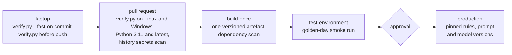

# Verification

`python scripts/verify.py` is the definition of done. At the end of the build, every gate passes,
with 407 tests at 96 % coverage. This build has no CI ([`PLAN.md`](../PLAN.md), Cuts), so this
says what runs today, what showed the checks can fail, where each check would run in a full
delivery, and what nothing runs yet.

## The result at the end of the build

On macOS with Python 3.14.7, at M8:

```text
Gate             Result  Seconds  Detail
---------------  ------  -------  ------
black            PASS        0.2  69 files would be left unchanged.
pyflakes         PASS        0.2
mypy             PASS        0.3  Success: no issues found in 69 source files
pytest           PASS        4.9  407 passed in 4.50s
golden checksum  PASS        0.0  4 files match SHA256SUMS
secrets          PASS        0.1  99 files checked
smoke            PASS        0.2  golden replay: the answer key's payment counts, a pack per case

verify: every gate passed
```

The same run in a copy of the working tree with no `.git`, as a ZIP download gives, passed
every gate too, its secrets line reading
`99 files checked (no Git checkout: .gitignore read directly)`. That copy used the existing
virtual environment, with `PYTHONPATH` pointing at its own `src/`, so its install step didn't
run.

Coverage is 96 %: 1,654 statements, 62 of them not run, from
`python -m pytest --cov=mule_triage --cov-report=term`. The gate enforces a floor of 80 %. No
test is marked skip or expected-failure.

## The gates

`python scripts/verify.py` runs every gate, in order, and prints the table above:

1. **black**, the formatting check;
2. **pyflakes**, the lint;
3. **mypy**, in strict mode, over `src/`, `tests/` and `scripts/`, targeting Python 3.11;
4. **pytest** over every test folder, with an 80 % coverage floor on the package;
5. **the golden checksum** of my answer key, the golden README and both data files, listed in
   `tests/golden/expected/SHA256SUMS` by their paths in `tests/golden/`. A missing or changed
   file fails it, as do a file in `expected/` that isn't listed, a listed path outside
   `tests/golden/` and a missing answer key;
6. **a secrets check** over every file Git tracks or would track. Outside a Git checkout, such
   as a ZIP download, or without Git installed, it walks the folder instead and scans every file
   the root `.gitignore` doesn't ignore; in this checkout both ways list the same 99 files;
7. **a smoke run** of `python -m mule_triage run` on the golden data in replay mode, into a new
   temporary database and folder. It checks for exit code 0, the summary's payment counts
   against the answer key's `[ingest]` section, a new case for each account the key doesn't give
   its default outcome, and one Markdown and one JSON pack for each.
   `tests/e2e/test_run_command.py` runs the same check under pytest.

Before any of them, it checks that every direct dependency is installed, that nothing installed
differs from its pin in `constraints.txt`, and that the package loads from this checkout.
`--fast` runs only gates 1, 2, 5 and 6, in under a second, and the commit hook runs it before
every agent commit. `python3 scripts/quickstart.py` sets up `.venv` and runs the full set.

## How the suite grew

Every milestone added tests, and S, which moved files without changing logic, kept the count
exactly. Counted with `pytest --collect-only` on each milestone's commit:

| Milestone | Tests |
| --- | --- |
| M1, skeleton, gates and architecture tests | 71 |
| M2, golden scenario and contracts | 113 |
| M3, store, ingest and reconciliation | 149 |
| M4, signals, rules and outcomes | 226 |
| M5a, evidence pack and reports | 259 |
| M5b, audit and dispositions | 280 |
| M6 part 1, prompt, validator and template | 334 |
| M6 part 2, model clients and degrade mode | 375 |
| M6 part 3, recordings and live evaluation | 376 |
| S, subpackages | 376 |
| M7, run summary, JSON logs and smoke test | 399 |
| R, the narrative the reviewer reads | 404 |
| P, a ZIP download without Git | 407 |

## Acceptance against the golden scenario

The golden day is the oracle: I wrote its answer key, and the checksum gate stops anything
changing it unnoticed. `tests/golden/test_golden.py` runs the pipeline on it and checks:

- the payment ingest counts and the rejected and duplicate IDs, and that ingesting the same
  files again stores nothing new;
- each listed account's outcome, priority, INCOMPLETE flag and reasons, and that every other
  account gets the default outcome;
- that ACC-101's pack lists 5 of its 9 counterparties, and keeps the injected reference as quoted
  data.

`tests/golden/test_recordings.py` checks that every golden alert has a recording for the current
prompt version and model, and pins the verdict each recording gets, below.

## Live evaluation of the narrative (M6)

A smoke test of real output, not a measured rate: only the two golden alerts, ACC-101 and
ACC-106, get drafts, and ACC-105, as NEEDS_REVIEW, gets the template without asking the model.
The reading has no pass mark: the AI narrative metric was cut ([`PLAN.md`](../PLAN.md), Cuts).

- **Model:** `granite3.3:8b`, with prompt `narrative-v1`, temperature 0, seed 42 and `num_ctx`
  8192. I recorded both replies with `--ai live --record`, read them and committed them
  (`tests/ai/recorded/`). Each recording, and each NARRATIVE audit event, holds the model's
  digest from Ollama, so the exact model build is on record.
- **Latency:** 69.57 seconds for ACC-101 and 52.94 seconds for ACC-106, from the recording run's
  output. The first is over the default 60-second timeout, which is why the recording command in
  [`operate.md`](operate.md) raises it to 300.
- **Acceptance:** 0 of 2 drafts. By sentence, 4 of 11 have no problem: 2 of ACC-101's 6, and 2
  of ACC-106's 5. Both cases get the template with the validator's reasons, and the run exits 0.
- **Rejection reasons:** 10 `UNSUPPORTED_DATE` and 4 `UNSUPPORTED_NUMBER`, 5 and 2 for each case;
  no other reason. Four are real errors: ACC-101's "$4500" received (the facts give seven
  payments of 900.00) and its payments out "between 09:00 and 11:30" (13:00 and 14:00); and
  ACC-106's "received 90%" (it sent on 0.90) and "$600" sent to ACC-351 (2700.00). The rest are
  right values in another form: "95%" for 0.95, and a date or time without the full timestamp
  the facts show. Nothing flagged ACC-106's sentence 4, which lists four of its five payers.
- **A second model, for comparison:** I also tried a `llama` model. One of its drafts passed the
  validator, but held factual errors, which is why optional item N would turn that draft into a
  failing hand-written test. Its replies weren't kept.
- **To repeat it:** `python -m mule_triage run tests/golden/payments.jsonl
  tests/golden/profiles.jsonl --as-of 2026-11-03T00:00:00Z --db <new file> --out <folder>`
  replays the recordings and prints `REJECTED: 2`; each reason is in the `NARRATIVE` audit
  event, and `show` prints them. `tests/golden/test_recordings.py` pins the reason counts, so a
  new recording or a changed validator must update this section.

## Testing the tests (M7)

Each deliberate bug was applied on its own to a clean tree as S left it, before M7's changes;
`verify.py` failed, and after the revert `git diff` was empty.

1. **An Unknown account age is treated as an old account:** in `detection/rules.py`,
   `outcome_for` stopped counting an Unknown signal (`unknowns += 1` removed), so a missing
   profile counted as not breaching. 18 tests failed, among them the golden acceptance test
   (ACC-105 dropped to NO_ALERT and ACC-106 to MEDIUM, no longer INCOMPLETE),
   `tests/unit/detection/test_rules.py`'s "one breach and one Unknown" and "two breach and one
   Unknown" cases, `tests/unit/test_evidence.py`'s missing-profile test, the narrator's
   NEEDS_REVIEW test and the end-to-end run. Applied again to M7's code, it failed 22 tests and
   the new smoke gate too: 2 cases and 4 packs, not 3 and 6.
2. **The validator stops checking citations:** in `narrative/validator.py`, the checks for a
   sentence citing no fact and for a fact outside the pack were removed, and unknown fact IDs
   skipped. 3 tests failed, all in `tests/unit/narrative/test_validator.py`:
   `test_rejects_a_sentence_that_cites_no_fact`,
   `test_rejects_a_sentence_that_cites_a_fact_outside_this_pack` and
   `test_a_problem_never_quotes_the_models_free_text`. Nothing beyond the validator's own unit
   tests would notice: the golden recordings cite real facts, so their replay test still passed.

Both gave the same table, apart from the seconds:

```text
Gate             Result  Seconds  Detail
---------------  ------  -------  ------
black            PASS        0.9  65 files would be left unchanged.
pyflakes         PASS        0.3
mypy             PASS        0.3  Success: no issues found in 65 source files
pytest           FAIL        3.7  exit code 1
golden checksum  PASS        0.0  4 files match SHA256SUMS
secrets          PASS        0.1  95 files checked
smoke            PASS        0.2  python -m mule_triage --help

verify: FAILED (pytest)
```

The smoke gate ran `--help` until M7, which is why it passed here.

## The guard's own tests

`.cursor/hooks/guard_tests.py` runs the hook guard against sample hook events, in a throwaway
sandbox repository. The guard stops the agent running it, so I ran it by hand at M8:
`CASES: 113  FAILURES: 0`.

## Where each check would run

| Stage | What would run there |
| --- | --- |
| Locally | `python scripts/verify.py`, with `--fast` before every agent commit |
| Pull request | The same command on clean Linux and Windows runners, on Python 3.11 and the latest release; the guard's own tests; and a secrets scanner over the full Git history |
| Delivery pipeline | One artefact, built once, with a dependency scan; deployed to a test environment and smoke-tested there with the golden scenario; promoted with an approval; rolled back by pinning the rules, prompt and model versions |



Only the first stage exists in this build. Because the gates are one command with no network
and no model, the pull-request stage is that same command on a clean runner, and the golden
scenario doubles as the deployed smoke test.

## Known gaps

- **What no CI leaves unrun:** Python 3.11 itself, since only 3.14 has run these gates; Windows;
  and a clean checkout on every push. The pins in `constraints.txt` are proven only on macOS
  with Python 3.14.
- **No secrets scan of the history:** the secrets check reads the current files, not past
  commits, and uses a handful of patterns rather than a full scanner. There's no dependency scan.
- **Without Git, the secrets check reads only the root `.gitignore`,** with Python's `fnmatch`:
  no nested `.gitignore` files, `**` patterns or global excludes. This repository uses none of
  them, and the two ways list the same files here, but a new pattern of that kind would make
  them differ.
- **The version checks at the top of `verify.py` and `quickstart.py`** are skipped by mypy and
  run by no test. They were checked by hand with Apple's Python 3.9.6.
- **The guard's own tests** run only when I run them by hand.
- **Concurrency is tested in sequence:** two reviewers on one version are tested one after the
  other; the threaded test (T) wasn't built.
- **Open review findings,** in [`agentic-workflow.md`](agentic-workflow.md): among them, the
  validator can miss an account ID that isn't in the pack, and other forms of its decision words
  (R2 and R3, confirmed in memory at M8), and a blank line counts as a rejected record (R8).
- **The end-to-end log test never sees a `model_call` record,** which is logged only for a live
  reply, and neither replay nor an unreachable model gives one. Its fields are pinned in memory
  instead, by `tests/integration/test_narrative_run.py`.
- **The architecture rules read code as written,** so they miss what only shows when it runs:
  imports made through `importlib`, the clock or `eval` reached through `getattr` or `builtins`,
  `from os import system`, and SQL assembled without an uppercase SQL keyword in the literal
  text.
